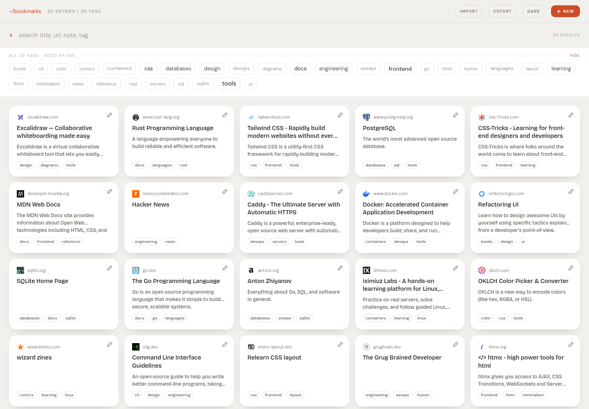
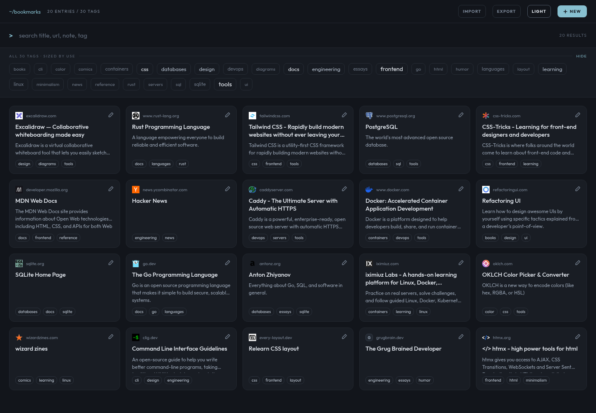
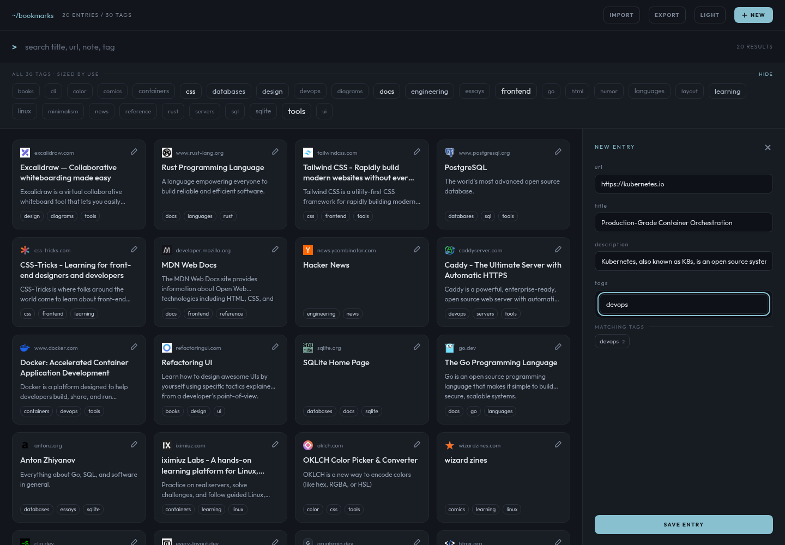
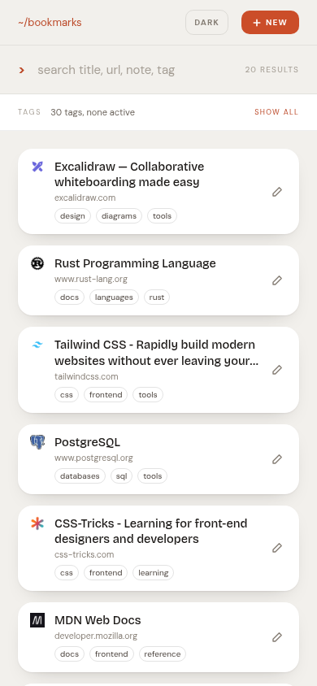

# Bookmarks

A self-hosted bookmarks manager in a single 5.5 MB static binary. Paste a URL and the server fetches the page to fill in the title, description and favicon; find anything again by live search or by combining tags. All data lives in one SQLite file on your host.



<details>
<summary>More screenshots — dark theme, the entry drawer, mobile</summary>







</details>

## Features

- **Metadata inference** — paste a URL, the server fetches the page for title, description and favicon. Everything stays editable.
- **Live search** across title, URL, description and tags at once.
- **Tag filtering** — tags combine with AND, sized by how often you use them.
- **Import/export** — JSON, or a browser's `bookmarks.html`. Folders become tags.
- **No build step, no JavaScript framework, no external requests.** Fonts and UI ship inside the binary.
- **Multi-arch** — `linux/amd64` and `linux/arm64`.

## Installation

You do not need to clone this repository. [`docker-compose.yml`](docker-compose.yml) is self-contained — save that one file and run:

```bash
mkdir -p data
docker compose up -d
```

Open <http://localhost:8080>.

> **Create `data/` yourself, before the first start.** If you let Docker create it, the directory ends up owned by root, the unprivileged container cannot write to it, and the app restart-loops on `unable to open database file`.

The container runs as `1000:1000`, which must match the owner of `data/`. If `id -u` says otherwise:

```bash
echo "UID=$(id -u)" >> .env
echo "GID=$(id -g)" >> .env
docker compose up -d
```

Change the published port with `BOOKMARKS_PORT=9000 docker compose up -d`.

### Without compose

```bash
mkdir -p data
docker run -d --name bookmarks --restart unless-stopped \
  -p 8080:8080 -u "$(id -u):$(id -g)" -v "$PWD/data:/data" \
  ghcr.io/anb98/bookmarks:latest
```

## Configuration

Every setting is an environment variable. The app starts with none of them set.

| Variable | Default | Meaning |
|---|---|---|
| `BOOKMARKS_ADDR` | `:8080` | Listen address inside the container |
| `BOOKMARKS_DB` | `/data/bookmarks.db` | SQLite file. WAL sidecars land beside it |
| `BOOKMARKS_THEME` | `dark` | Initial theme (`light` or `dark`) for a browser with no saved preference |
| `BOOKMARKS_ALLOW_PRIVATE_NET` | `false` | Allow metadata fetches to private/internal addresses. See [Security](#security) |
| `BOOKMARKS_FETCH_TIMEOUT` | `8s` | Timeout for one outbound metadata fetch |
| `BOOKMARKS_MAX_FETCH_BYTES` | `1048576` | Cap on a fetched page (1 MiB) |
| `BOOKMARKS_MAX_FAVICON_BYTES` | `65536` | Cap on a stored favicon (64 KiB) |
| `BOOKMARKS_MAX_IMPORT_BYTES` | `33554432` | Cap on an import upload (32 MiB) |
| `BOOKMARKS_USER_AGENT` | `Mozilla/5.0 (compatible; bookmarks/1.0)` | Some sites reject the default Go user agent |

## Usage

| Action | How |
|---|---|
| Add a bookmark | `NEW`, paste a URL. Title and description fill in on their own and stay editable — whatever you type wins |
| Tag it | Type in the tag field. `MOST USED` shows existing tags; no match offers `+ create` |
| Search | Type in the search row. Matches title, URL, description and tags at once |
| Filter | Click tags in the band. Multiple tags combine with **AND** |
| Show the tags | Below 1024px the band starts collapsed. Tap anywhere on the `TAGS` strip to expand it |
| Open a bookmark | Click the card. It is a real link, so middle-click and "open in new tab" work |
| Edit or delete | Click the **pencil** at the card's corner. `DELETE ENTRY` is permanent |
| Import / export | `EXPORT` writes JSON. `IMPORT` accepts that JSON **or** a browser's `bookmarks.html` |

Import matches on URL and updates rather than duplicating: title and description are filled only if empty, tags are merged, and one bad row is skipped rather than failing the file. Browser folders become tags, with each nesting level contributing one (`Work > Clients > Acme` yields three) and generic containers like `Bookmarks bar` skipped. **Import never fetches metadata** — a 500-row import would otherwise fire 500 outbound requests.

## Updating

```bash
docker compose pull
docker compose up -d
```

`:latest` follows `main`. To decide yourself when to move, pin a commit tag in `docker-compose.yml`:

```yaml
image: ghcr.io/anb98/bookmarks:<sha>
```

## Backup

The whole collection is one file:

```bash
cp data/bookmarks.db backup.db
```

Do it while the app is stopped, or use `sqlite3 data/bookmarks.db ".backup backup.db"` to include the WAL safely. `EXPORT` in the UI writes portable JSON if you would rather not copy the database.

## Security

### No authentication

There is no login, and anyone who can reach the port has full read and write access. Bind it to a trusted network, or put it behind a reverse proxy that handles authentication.

### SSRF is the real risk here

The metadata endpoint makes the **server** fetch a URL **you** supply. Combined with no authentication, anyone who can reach this app could otherwise use it to probe services only reachable from the server — cloud metadata endpoints, admin panels on localhost, devices on your LAN.

Fetches to these are refused by default:

- loopback (`127.0.0.0/8`, `::1`)
- private ranges (`10/8`, `172.16/12`, `192.168/16`, `fc00::/7`)
- link-local, including the cloud metadata address `169.254.169.254`
- `100.64.0.0/10` — carrier-grade NAT, **and the range Tailscale uses**
- `198.18.0.0/15` and `192.0.0.0/24`
- multicast and unspecified addresses
- any scheme other than `http` and `https`

Two details matter more than the list. The check runs against the **resolved IP**, not the hostname, so a domain pointed at `127.0.0.1` is still refused. And it re-runs on **every redirect hop**, so a public URL redirecting to an internal one dies on the second hop.

`BOOKMARKS_ALLOW_PRIVATE_NET=true` removes this protection. Saving a bookmark never required the fetch to succeed, so you can add an internal URL by hand and type its title yourself instead.

### Other measures

| Concern | Measure |
|---|---|
| Stored titles rendered in the page | The frontend never uses `innerHTML`; all text goes through `textContent` |
| Favicons as an attack vector | Served only with an allowlisted image type, plus `nosniff` and `default-src 'none'; sandbox` |
| Third-party favicon services | None used. Only the site's own declared icon or `/favicon.ico` |
| Oversized or slow responses | Timeout, byte cap, and a 5-hop redirect limit on every fetch |
| Import uploads | 32 MiB cap, per-row error collection, no outbound requests |

## Accessibility

Keyboard navigation and focus rings work throughout, and tag pills expose their frequency to screen readers (`"go, 6 bookmarks"`) because it is conveyed visually by size and brightness alone.

**One documented exception.** In the tag cloud, low-frequency tags are deliberately dim and small — that contrast difference *is* the information channel. Raising those tones to meet WCAG AA would erase the signal. This is a considered trade-off confined to the least important content on the page. Every other text tone, and the accent used for buttons and links, meets AA (4.5:1 or better).

## Building from source

Compose consumes the published image, so `docker-compose.yml` has no build context. To run your own build, tag it with the name compose already expects:

```bash
docker build -t ghcr.io/anb98/bookmarks:latest .
docker compose up -d
```

`docker compose pull` overwrites that tag again with the published image.

## Development

```bash
go test ./...     # 74 tests, no external dependencies
go vet ./...
gofmt -l .

BOOKMARKS_DB=/tmp/dev.db BOOKMARKS_ADDR=:8080 go run .
```

Two dependencies: `modernc.org/sqlite` (pure Go, so the binary is genuinely static and cross-compiles to arm64 without a C toolchain) and `golang.org/x/net/html` (for parsing untrusted remote HTML).

The frontend is native ES modules under `web/js/`, plus `web/index.html` and `web/app.css` — no build step, no npm, no framework. Everything, fonts included, is embedded with `go:embed`, so the app makes no external requests to render.

The `scratch` base is what keeps the image at 5.5 MB; `python:3.13-alpine` starts at 70.3 MB and `node:24-alpine` at 234 MB before any application code. Measure with `docker image inspect --format '{{.Size}}'` — `docker images` reports inflated numbers for this image.
